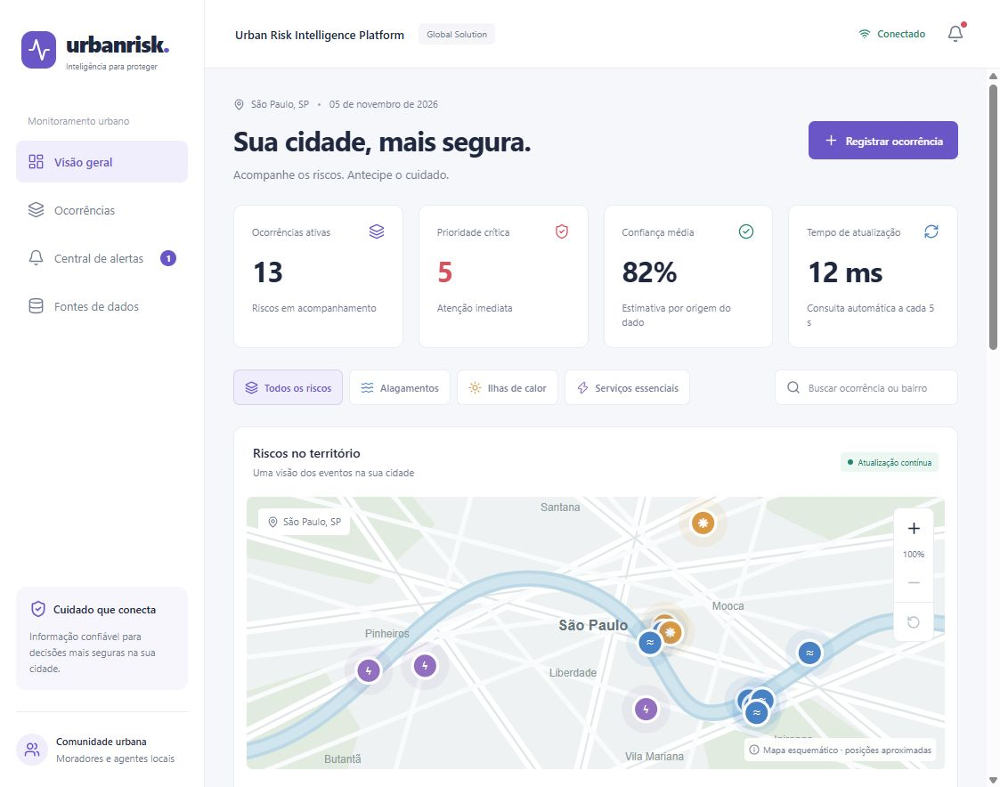

# Urban Risk Intelligence Platform

**Global Solution 2026.2 · Engenharia da Computação · Advanced Programming And Mobile Dev**

Plataforma de monitoramento de **alagamentos, ilhas de calor e interrupções de serviços essenciais**. Uma API Java/Spring Boot recebe observações de sensores, bases públicas e moradores, persiste os registros e calcula uma prioridade explicável. O aplicativo React Native/Expo apresenta painel, eventos, origem, confiança, recomendações e alertas, com atualização automática e recuperação de conexão.



## Integrantes

| Nome completo | RM |
| --- | --- |
| João Viviani Baldini | 558596 |
| Giuliano Ferreira Venceslau | 558674 |
| Enrico Nikolay Meirelles Zeronian | 558557 |

## Executar as duas stacks

Pré-requisitos: **JDK 17**, **Maven 3.9+**, **Node.js 24 LTS** e npm. O aplicativo usa **Expo SDK 58**, React Native 0.88 e React 19.3. Para celular físico, use Expo Go compatível com SDK 58 e mantenha o computador e o telefone na mesma rede. Confira `java -version`, `javac -version`, `mvn -version` e `node --version` antes de começar.

```powershell
git clone https://github.com/joao-baldini/GS2-Advanced-Programming-Mobile-Dev.git
cd GS2-Advanced-Programming-Mobile-Dev
```

**Terminal 1, na raiz: backend.**

```powershell
cd backend
mvn spring-boot:run
```

Mantenha o terminal aberto. A API fica em [localhost:8080/api/events](http://localhost:8080/api/events); o health check, em [localhost:8080/actuator/health](http://localhost:8080/actuator/health). Na primeira execução, oito registros **simulados** são inseridos no banco vazio. O banco H2 em arquivo fica em `backend/data/urbanrisk.mv.db`, não é versionado e preserva os registros após reiniciar a API. Execute o Maven sempre dentro de `backend/` para manter o mesmo caminho do banco.

**Terminal 2, na raiz: aplicativo na prévia web.**

```powershell
cd frontend
npm ci
npm run web
```

Abra [localhost:8081](http://localhost:8081). Esta é a versão web do **mesmo código React Native**, com React Native Web; não é um frontend separado. A interface se adapta a celular e desktop. A aplicação não apresenta mocks locais no fluxo de consulta: tudo vem da API ou do cache identificado como desatualizado quando há falha.

### Android e iPhone

Em um terminal aberto em `frontend/`, use `ipconfig` para descobrir o IPv4 do computador, substitua o IP abaixo e execute:

```powershell
$env:EXPO_PUBLIC_API_URL="http://192.168.0.10:8080"
npx expo start --clear
```

Leia o QR Code com o Expo Go compatível. No iPhone, use a câmera; no Android, o leitor do Expo Go. Teste antes `http://IP-DO-COMPUTADOR:8080/api/events` no navegador do próprio telefone. Se não abrir, confira o endereço, a rede e as regras do firewall para Java/porta 8080. `localhost` no telefone aponta para o telefone, não para o computador. O app não precisa de câmera, localização ou cadastro pessoal.

| Ambiente | URL padrão da API |
| --- | --- |
| Web e simulador iOS na mesma máquina | `http://localhost:8080` |
| Emulador Android | `http://10.0.2.2:8080` |
| Celular físico | `http://IP-DO-COMPUTADOR:8080`, via variável de ambiente |

Alternativa: copie `frontend/.env.example` para `frontend/.env.local` e ajuste o IP. Reinicie o Expo ao alterar essa configuração. A URL não contém chave de ingestão; variáveis `EXPO_PUBLIC_*` são públicas no aplicativo.

## Como demonstrar a solução

1. Com backend e Expo ativos, confira `GET /api/events` e `GET /api/dashboard`. Compare um registro com o painel do app.
2. Abra o detalhe de uma ocorrência. Mostre tipo, fonte, confiança, horário, leitura, pontuação, quatro fatores e recomendação. A rota de detalhe consulta novamente a API; se ela falhar, o detalhe identifica a consulta salva.
3. Toque em **Registrar ocorrência**, informe título, bairro, descrição, severidade e estimativa de pessoas afetadas. O registro é enviado por `POST /api/events` e recebe ID do backend. Compare com o JSON.
4. Toque em **Simular leitura** ou execute o comando abaixo em outro terminal. Não atualize a página: em aproximadamente 5 segundos, o evento aparece no painel e, se prioritário, na **Central de alertas**. O primeiro carregamento estabelece a referência e não gera notificações dos registros antigos.
5. **Pare apenas o backend** com `Ctrl+C` no Terminal 1. Mantenha o Expo e o app abertos. Em até aproximadamente 8 segundos (intervalo de 5 s + timeout de 3 s), o app mostra **Desconectado** e **Backend desconectado**. A última consulta permanece visível, com horário e aviso de desatualização. Navegação, busca e leitura do cache continuam disponíveis.
6. Execute novamente `mvn spring-boot:run` no Terminal 1. Depois da inicialização da API, o app reconecta na próxima consulta, mostra **Conexão restabelecida** por alguns segundos e atualiza os dados sozinho. Os IDs anteriores permanecem no H2.

```powershell
curl.exe -X POST http://localhost:8080/api/demo/reading
```

O simulador permite uma leitura a cada 5 segundos, retorna `429` em excesso e só existe com `DEMO_ENABLED=true`. Ele cria observações **simuladas**, não altera o estado de conexão. Para testar desconexão, é necessário parar a API de verdade.

### Alertas e atualização

- Consulta periódica a cada 5 s com timeout de 3 s por requisição, sem consultas concorrentes do mesmo ciclo.
- Novos eventos ativos com pontuação ≥ 60 alimentam o contador e a central do aplicativo. A central mantém até 100 alertas da sessão; **Marcar como lidos** limpa essa lista, sem apagar eventos da API.
- Android/iOS oferecem **Ativar notificações** na central. Após permissão, são disparadas notificações locais para novos alertas enquanto o app está em execução. Na web, os avisos ficam dentro do aplicativo.
- Não há push remoto nem monitoramento garantido em segundo plano. O polling pausa quando o app vai para segundo plano e atualiza quando ele retorna.
- O último snapshot é salvo com AsyncStorage (armazenamento local no navegador). Cache não é uma nova medição e não serve como confirmação de que o risco continua ativo. Formulários com falha de envio permanecem preenchidos durante a sessão; não há fila de envios offline.
- O painel informa a duração do ciclo de consulta em milissegundos. Isso é **latência medida**, não o intervalo de polling nem um SLA. A exibição de um novo evento normalmente inclui espera de até um intervalo mais o tempo de rede.

## API REST

| Método e rota | Uso | Acesso |
| --- | --- | --- |
| `GET /api/events` | Lista paginada globalmente ordenada por prioridade | Público |
| `GET /api/events/{id}` | Detalhe com análise | Público |
| `GET /api/dashboard` | Contagens, confiança média e horário do servidor | Público |
| `POST /api/events` | Registro comunitário | Público, validado |
| `POST /api/observations` | Ingestão de sensores e bases públicas | `X-Ingestion-Key` |
| `PATCH /api/events/{id}/status` | `ACTIVE`, `MONITORING` ou `RESOLVED` | `X-Ingestion-Key` |
| `POST /api/demo/reading` | Leitura simulada para demonstração | Apenas modo demo |
| `GET /api/demo/status` | Disponibilidade do simulador | Apenas modo demo |
| `GET /actuator/health` | Verificação de disponibilidade | Público, sem detalhes internos |

Filtros opcionais: `type=FLOOD|HEAT|SERVICE`, `status=ACTIVE|MONITORING|RESOLVED`, `neighborhood=Ipiranga`, `page=0`, `size=20` (máximo 100). Resposta: `{items, total, page, size, serverTime}`. Empates são desfeitos por observação mais recente e ID. Datas usam ISO-8601/UTC; o aplicativo exibe a hora local do dispositivo.

Todas as categorias usam o contrato de [exemplos JSON](docs/examples). Os campos incluem título, descrição, tipo, severidade, bairro, pessoas estimadas, coordenadas, origem, identificação da fonte, leitura opcional, unidade e data de observação. `confidence`, ID e data de criação são definidos pelo servidor. A rota comunitária rejeita `SENSOR` e `PUBLIC_DATA` e fixa a fonte em **Relato comunitário**; credibilidade não pode ser promovida pelo formulário.

Ingestão autenticada, partindo da raiz do repositório:

```powershell
curl.exe -X POST http://localhost:8080/api/observations -H "Content-Type: application/json" -H "X-Ingestion-Key: urbanrisk-local-demo" --data-binary "@docs/examples/sensor.json"
curl.exe -X POST http://localhost:8080/api/observations -H "Content-Type: application/json" -H "X-Ingestion-Key: urbanrisk-local-demo" --data-binary "@docs/examples/public-data.json"
```

`urbanrisk-local-demo` é uma chave pública exclusiva para desenvolvimento local. Configure `INGESTION_KEY` no servidor em outro ambiente e distribua-a apenas a coletores autorizados. A chave não é incorporada ao app. Exemplos adicionais estão em [docs/api.http](docs/api.http), utilizável com a extensão REST Client do VS Code.

### Origens e limites dos dados

O projeto entrega ingestão normalizada das três origens. Sensores e boletins iniciais são **simulados**, identificados por `simulated=true` e pelo nome da fonte. Não há conexão automática com equipamentos ou bases governamentais ao vivo. Para usar uma base real, um coletor autorizado deve transformar seu registro para o JSON da API, informar fonte verificável, `observedAt` real e `simulated=false`. O próprio POST autenticado é a interface de importação.

### Importar uma base pública real

O coletor incluído consulta a temperatura atual do modelo meteorológico [Open-Meteo](https://open-meteo.com/en/docs) para a região da Sé. Com a API ativa, execute **na raiz do repositório**, usando Node.js 24:

```powershell
node scripts/import-public-weather.mjs
```

Ele acessa a internet, valida valor/unidade/horário e envia uma observação `PUBLIC_DATA` com `simulated=false` à ingestão autenticada. O app recebe o registro no próximo ciclo. Abaixo de 30 °C, a severidade é baixa e a situação é ajustada para `MONITORING`; não é descrita como emergência. Não se presume quantidade de pessoas afetadas. Os limiares de temperatura são regras demonstrativas, sem calibração epidemiológica.

O Open-Meteo fornece **estimativas de um modelo meteorológico**, não um sensor de rua nem confirmação de ilha de calor. O texto do registro preserva essa limitação e a referência da fonte. Cada execução importa uma observação; não há agendamento nem deduplicação automática. O restante do app funciona mesmo quando essa fonte externa está indisponível.

Configuração opcional do coletor: `INGESTION_KEY` (mesma chave do servidor) e `URBANRISK_API_URL` (padrão `http://localhost:8080`). A chave nunca é enviada ao Open-Meteo. Se uma fonte externa falhar ou retornar dados inválidos, o coletor informa o erro e não inventa uma leitura.

A visão territorial é um **mapa esquemático**, sem tiles externos ou navegação. Posições são aproximadas e limitadas ao recorte de São Paulo; relatos do formulário usam o centro da cidade, mantendo o bairro informado. Os detalhes permitem abrir as coordenadas no OpenStreetMap. A lista é a referência para eventos sobrepostos ou fora do recorte.

## Recurso de análise para priorização

Foi escolhida a alternativa de **análise**, prevista no enunciado. É um modelo multicritério determinístico e explicável, sem treinamento de IA e sem depender de serviços pagos.

```text
prioridade = severidade + confiança + impacto estimado + recência
```

| Fator | Regra |
| --- | --- |
| Severidade | `LOW=10`, `MEDIUM=22`, `HIGH=34`, `CRITICAL=45` |
| Confiança | Sensor 90%, base pública 95%, comunidade 60%; `round(confiança × 25)` |
| Impacto | `min(20, round(log10(max(1, pessoas afetadas)) × 6))` |
| Recência | Idade em minutos inteiros: até 30 → 10; até 120 → 7; até 1.440 → 3; depois → 0 |
| Resolução | Um evento `RESOLVED` tem prioridade 0 e sai das contagens de riscos ativos |

Faixas: **crítico ≥ 80**, **alto ≥ 60**, **moderado ≥ 40**, **baixo < 40**. Severidade declarada e prioridade calculada são conceitos distintos. Um calor de severidade alta pode receber prioridade crítica pela combinação de fatores.

Exemplo: sensor crítico, 1.800 pessoas e leitura recente → `45 + 23 + 20 + 10 = 98`. A pontuação decai pela recência, mesmo sem um novo cadastro. O banco ordena globalmente antes de paginar; o detalhe explica os quatro fatores.

Os percentuais de confiança são **hipóteses de triagem por categoria**, não probabilidades calibradas ou comprovação de autenticidade. Não há deduplicação espacial, consenso entre sensores, detecção de fraude ou previsão meteorológica. Os alertas apoiam análise humana e não substituem fontes oficiais.

## Arquitetura, disponibilidade e privacidade

```text
React Native / Expo (Android, iOS, Web)
  componentes e telas → hook de sincronização → serviços HTTP
       ↕ cache AsyncStorage e central de alertas
       ↕ API REST / JSON
Spring Boot
  controller + DTO/validação → service/análise → repository/JPA → H2 file
       ↑ coletores autenticados: sensores e bases públicas
```

- Backend separado em `controller`, `dto`, `service`, `repository`, `model` e `config`.
- API sem estado de sessão, filtros e paginação no banco, índice de status/tipo/data, prioridade base materializada e recência calculada na consulta. Indicadores usam agregações no banco.
- H2 é adequado à demonstração com **uma instância**. O driver PostgreSQL está incluído; configurar URL/usuário/senha permite planejar armazenamento externo, mas esta entrega foi validada em H2. A aplicação não implanta cluster, balanceador, backups ou réplica automaticamente.
- O app limita sua consulta às 1.000 ocorrências de maior prioridade para proteger memória e rede. A API permite continuar a paginação. Em uma implantação maior, a evolução prevista é paginação incremental no cliente, filtros remotos, migrações Flyway e transporte por SSE/push conforme a necessidade.
- Cache, timeout, reconexão automática e health check dão suporte à disponibilidade percebida. Não garantem disponibilidade do servidor.
- Cadastro sem nome, CPF, e-mail ou telefone, orientação para evitar dados pessoais, localização aproximada e chave restrita aos coletores. Não há telemetria de localização nem login de moradores.
- CORS limitado às origens configuradas, limites de texto/valores, erros sem stack trace e alterações de status protegidas. Validação de coordenadas e observações futuras no servidor.
- Para implantação real: HTTPS, segredo próprio, `DEMO_ENABLED=false`, rate limiting, autenticação de agentes, moderação de conteúdo, política de retenção e migrações versionadas. `ddl-auto=update` é uma configuração de desenvolvimento. Evite dados pessoais nos campos livres; não se afirma conformidade integral de produção.

Variáveis do backend:

| Variável | Padrão local |
| --- | --- |
| `PORT` | `8080` |
| `DATABASE_URL` | `jdbc:h2:file:./data/urbanrisk;DB_CLOSE_ON_EXIT=FALSE` |
| `DATABASE_USER`, `DATABASE_PASSWORD` | `sa`, vazia |
| `INGESTION_KEY` | `urbanrisk-local-demo` |
| `DEMO_ENABLED` | `true` (desative fora da demonstração) |
| `ALLOWED_ORIGINS` | `http://localhost:8081,http://127.0.0.1:8081,http://localhost:19006` |

## Testar e verificar

```powershell
cd backend
mvn test
# Ou pacote executável + testes:
mvn verify

cd ../frontend
npm ci
npm test
npm run typecheck
npm run lint
npx expo install --check
npx expo-doctor
npm run build:web
# Opcional: verificar também a geração de bundles Android e iOS
npx expo export --platform all
```

O backend tem testes unitários da análise e testes de integração HTTP/JPA: persistência, origem, chave, validação, filtros, paginação global, métricas, CORS e ausência do simulador fora do modo demo. O frontend testa JSON, falha HTTP, timeout e recuperação da rede. O CI em [GitHub Actions](.github/workflows/ci.yml) verifica as duas stacks em cada push/PR.

O coletor público tem três testes adicionais de normalização e rejeição de dados inválidos. Execute na raiz: `node --test scripts/tests/*.test.mjs`.

O relatório de verificações e os limites de validação estão em [docs/VALIDACAO.md](docs/VALIDACAO.md). Para avaliar facilidade de uso, execute cadastro, leitura de um detalhe e recuperação da API com um morador e um agente, anotando tempo e dificuldades; não foi realizado estudo com usuários nesta entrega.

## Apresentação e entrega

- [Roteiro detalhado em Markdown](docs/ROTEIRO_APRESENTACAO.md), com preparação, comandos, cenas, falas e resultados esperados no estilo da Sprint 4.
- [Roteiro em PDF](output/pdf/Roteiro_Global_Solution_UrbanRisk.pdf).
- [ENTREGA_GS.txt](ENTREGA_GS.txt), com os três integrantes e o link do repositório, para enviar ao portal FIAP até **19/11/2026 às 23h55**.
- **Vídeo da apresentação: a gravar pela equipe.** Depois de publicar, acrescente aqui a URL real. O roteiro propõe cerca de 5 minutos; o enunciado fornecido não fixa duração.

O histórico de commits registra etapas de implementação, integração e documentação. Cada integrante deve realizar suas contribuições com a própria identidade Git; não são atribuídos commits fictícios a outros membros.

Referências técnicas: [Spring Boot / Java 17](https://docs.spring.io/spring-boot/3.5/system-requirements.html), [Expo para web](https://docs.expo.dev/workflow/web/) e [atualização/compatibilidade de SDK](https://docs.expo.dev/workflow/upgrading-expo-sdk-walkthrough/).
